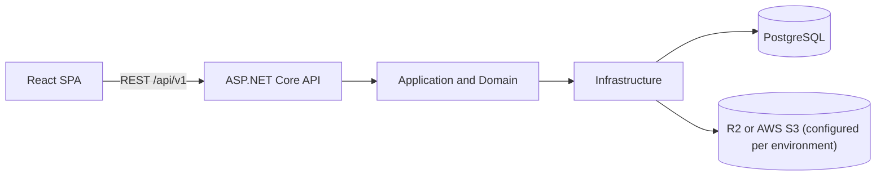

# FluentA

> A full-stack learning and productivity platform that combines vocabulary
> study, spaced repetition, and personal workflow management.

<p align="center">
  
</p>

[Overview](#overview) · [Features](#key-features) · [Architecture](#architecture) ·
[Getting Started](#getting-started) · [Documentation](#documentation)

## Overview

FluentA helps learners build vocabulary, practise with flashcards, and review
at the right time while managing the tasks and habits that support consistent
learning. It brings learning tools, personal planning, notes,
and progress tracking into one web application.

The repository contains a React single-page application and an ASP.NET Core
modular monolith. PostgreSQL is the durable store, and private object storage
holds assets through one S3-compatible adapter. Cleanup background jobs have been removed. Every environment uses the configured R2 or AWS S3 bucket. See [asset storage setup](docs/product/asset-storage-r2.md).

## Key Features

- Configurable vocabulary boards with multilingual columns and cell autosave.
- Flashcards, practice modes, review sessions, and spaced
  repetition scheduling.
- Daily and weekly todos, habit tracking, countdowns, and Project.
- Rich-text journal entries, notes, and profile settings.
- Email/password authentication, account recovery, and Google OAuth.

## Architecture



The backend keeps HTTP concerns in `FluentA.API`, use cases and
ports in `FluentA.Application`, business rules in `FluentA.Domain`, and
external service implementations in `FluentA.Infrastructure`. Controllers
share the API identity/error boundary, while bounded-context services keep
orchestration and delegate validation, mapping, statistics, and provider/query
hotspots to focused internal collaborators. See the
[backend guide](src/backend/README.md) for the current project layout.

## Tech Stack

| Area | Technologies |
| --- | --- |
| Frontend | React 19, TypeScript, Vite, React Router |
| Client state and data | TanStack Query, Zustand, Axios |
| Backend | ASP.NET Core, .NET 10, Entity Framework Core |
| Data and infrastructure | PostgreSQL 16, R2 or AWS S3 for assets, Docker Compose |
| Testing | xUnit, Vitest, Playwright |

## Engineering Highlights

- Modular-monolith boundaries separate domain rules from delivery and
  infrastructure concerns.
- Internal decomposition keeps the existing four projects and public contracts;
  it does not introduce CQRS, MediatR, or one handler per endpoint.
- A consistent `ApiResponse<T>` contract keeps frontend and backend error
  handling predictable.
- Mutations refresh queries in the current app; no realtime connection is used.
- Server-authoritative dates drive spaced repetition reviews.
- Unit and browser-level test suites cover business rules and critical user
  workflows.

## Getting Started

### Run the whole application locally with Docker

After configuring the existing backend user-secrets and `src/frontend/.env`
as described in [local setup](docs/local-development.md), start Docker Desktop
and run this command from the repository root in PowerShell 7:

```powershell
./start-local.ps1
```

This builds and starts PostgreSQL, a one-time migration container, the API,
and the frontend. Open `https://localhost:5173`; the API stays at
`https://localhost:7000`. The script exports your trusted .NET development
certificate, mounts existing backend secrets read-only, and uses the existing
frontend `.env` during build. The host needs .NET 10 for certificate setup;
Node.js runs inside Docker. R2, Google, Resend, and Azure Speech continue using
your existing credentials. This is a built frontend; rerun the command after
changing source or frontend configuration.

The database uses the same `fluenta-postgres-dev-data` volume as
`docker-compose.dev.yml`. Migrations apply to `fluenta_dev`; they do not erase
or reset the database. Stop any host API/Vite processes using ports 7000/5173
before starting the containers.

```powershell
./start-local.ps1 -Logs
./start-local.ps1 -Stop
```

The first command displays recent application logs. The second stops the local
containers while keeping PostgreSQL data. Do not use `down -v` if you want to
keep that data. Generated certificate files under `.local-docker/` are ignored
by Git and must remain local.

### Share the Docker application on the LAN (Windows)

Use your host's Wi-Fi IPv4 address (currently `192.168.1.164`):

```powershell
./start-local.ps1 -LanIp 192.168.1.164
```

This uses the LAN Compose override, creates HTTPS certificates with mkcert,
and builds a separate frontend configuration under ignored `.local-docker/`.
The original frontend `.env` and backend user-secrets remain unchanged. Open
`https://192.168.1.164:5173` on both the host and client computers in this mode;
using localhost with the LAN frontend would cross sites for authentication.
The certificate also covers localhost for health checks. Rerun with the current
Wi-Fi address if it changes. Running without `-LanIp` restores localhost mode.

The launcher needs `mkcert` on PATH or `.local-docker/tools/mkcert.exe` from
[the official Windows release](https://github.com/FiloSottile/mkcert/releases).
It installs the development CA into the host user's certificate trust store.
To allow clients, run this once in an administrator PowerShell terminal:

```powershell
./enable-lan-firewall.ps1 -LanIp 192.168.1.164
```

This permits only TCP 5173/7000 on the selected IP and interface, from its LAN
subnet. It works with either Public or Private network profiles; it does not
change the profile or expose the service through VPN interfaces. The existing
PostgreSQL port configuration is unchanged.

Copy only `.local-docker/lan-rootCA.cer` to each client you manage. On Windows,
install it for that user with this command, adjusting the copied file path:

```powershell
certutil -user -addstore Root "$env:USERPROFILE/Downloads/lan-rootCA.cer"
```

This trusts the development CA so HTTPS works without bypassing browser
warnings. Keep all private keys on the host; never share `rootCA-key.pem` or
`localhost.key`. On clients, verify the API at
`https://192.168.1.164:7000/health/ready` and open the website at port 5173.
Cross-device connectivity still depends on router Wi-Fi/client isolation.

Email/password login is the supported LAN test path. Google login requires
an accepted Google OAuth origin and is not configured for a private-IP origin.
Browser R2 uploads also require adding `https://192.168.1.164:5173` to the
bucket's existing CORS AllowedOrigins; this local setup does not change cloud
bucket policy. Stop with `./start-local.ps1 -Stop` to retain database data.

### Run the API and frontend directly on the host

Để chạy **đầy đủ chức năng trên localhost**, làm theo
[hướng dẫn local từng bước](docs/local-development.md). Hướng dẫn này có lệnh
PowerShell cho secrets, PostgreSQL, migration, API, frontend và checklist thử
Google, Resend, Azure Speech, R2 bằng credential thật.

### Prerequisites

- .NET 10 SDK, Node.js, npm, and PostgreSQL (Docker Compose is optional for the database)
- A Google Identity Services Web client ID for Google login
- A Resend API key and verified sender for registration OTP/password reset
- An Azure Speech region and subscription key for pronunciation assessment

### Environments

There are exactly two application environments:

| Environment | How it runs | Configuration |
| --- | --- | --- |
| Development | Developers run the API and Vite on their machine | Backend user-secrets/environment variables; frontend `src/frontend/.env` |
| Production | API supports Production configuration; deployment layout is being revised | External credentials and runtime configuration |

PostgreSQL can be installed locally or started with the optional development
Compose file. That file runs only the database. The API rejects runtime
environment names other than Development and Production.

### Development workflow

Requires the .NET 10 SDK, Node.js, npm, and PostgreSQL. Each developer supplies
their own database connection, application secrets, and external service keys.

#### 1. Install dependencies

Run from the repository root:

```powershell
dotnet restore src/backend/FluentA.slnx
npm --prefix src/frontend ci
if (-not (Test-Path src/frontend/.env)) {
  Copy-Item src/frontend/.env.example src/frontend/.env
}
```

#### 2. Configure development and start PostgreSQL

Set the required Jwt, OTP, Google, Resend, Azure Speech and R2 values with the
exact commands in the [local guide](docs/local-development.md). The API
validates Jwt, OTP, Google and Resend at startup.
For object storage, follow the [R2 configuration guide](docs/product/asset-storage-r2.md).
Frontend configuration belongs in `src/frontend/.env`.
Credentials are supplied by each developer and are not generated by a startup script.

If you already run PostgreSQL, set the connection string to that instance.
Otherwise, use the optional database container:

```powershell
docker compose -f docker-compose.dev.yml up -d
```

This starts PostgreSQL. Configure a private R2 bucket using the [asset storage guide](docs/product/asset-storage-r2.md).
The FluentA development database is `fluenta_dev`, exposed on
`localhost:5432`, and persisted in the Docker volume
`fluenta-postgres-dev-data`.

#### 3. Apply database migrations

```powershell
dotnet tool restore
dotnet tool run dotnet-ef database update `
  --project src/backend/FluentA.Infrastructure `
  --startup-project src/backend/FluentA.API
```

#### 4. Start the API

```powershell
dotnet run --project src/backend/FluentA.API --launch-profile https
```

The API is available at `https://localhost:7000`; its development OpenAPI
document is at `https://localhost:7000/openapi/v1.json`.

#### 5. Start the frontend

Open another terminal at the repository root:

```powershell
npm --prefix src/frontend run dev
```

Open `https://localhost:5173`.

### Production

The Azure VM deployment uses GitHub Actions, the `production` environment,
GHCR images and Docker Compose. Merge a `develop` to `main` pull request to
trigger a release after completing the [Azure deployment setup](deploy/azure/README.md).

## Usage

1. Register a new account or sign in.
2. Create a vocabulary board and add the columns needed for the target
   language.
3. Add words and use the synchronized flashcards for practice or scheduled
   review.
4. Plan learning with todos, habits, Project, and countdowns.
5. Capture longer-form content in Journal or Notes and track Habit progress
   through daily check-ins.

## Testing

```powershell
# Backend tests
dotnet test src/backend/FluentA.slnx --configuration Release --no-restore

# Frontend checks
npm --prefix src/frontend run check:architecture
npm --prefix src/frontend run lint
npm --prefix src/frontend run test:run
npm --prefix src/frontend run build

# Backend release checks
dotnet build src/backend/FluentA.slnx --configuration Release --no-restore
dotnet tool run dotnet-ef migrations has-pending-model-changes `
  --project src/backend/FluentA.Infrastructure `
  --startup-project src/backend/FluentA.API `
  --configuration Release

# Browser tests require the local stack to be running
npm --prefix src/frontend run test:e2e
```

## Project Structure

```text
src/
  backend/
    FluentA.API/                 HTTP and authentication
    FluentA.Application/         Use cases and application ports
    FluentA.Domain/              Entities and business rules
    FluentA.Infrastructure/      Persistence and external providers
  frontend/
    src/app/                     Application shell and router
    src/features/                Feature-owned UI and data access
    src/shared/                  Shared components, types, and utilities
    e2e/                         Playwright scenarios
docs/
  product/                       Current product contracts
  plans/                         Active and completed execution plans
  stories/                       Story scope and validation evidence
  decisions/                     Architecture decision records
```

## Documentation

- [Full localhost setup](docs/local-development.md)
- [Frontend development guide](src/frontend/README.md)
- [Backend and API guide](src/backend/README.md)
- [Documentation map](docs/README.md)
